# Humaneness Podcast Server

**A script in, a complete podcast out.** This standalone FastAPI service turns a structured conversation into **128 kbit/s mono MP3** using LAION's full [Humanness Voice Podcast checkpoint](https://huggingface.co/laion/Humanness-Voice-Podcast), a fine-tune of Humaneness Voice Large 1.7. Submit a job, receive an ID immediately, poll detailed progress, then download the episode. Completed candidate checkpoints survive worker crashes and service restarts.

**[Live HTTPS service](https://arrive-locations-parade-research.trycloudflare.com/podcast/)** · **[Interactive API](https://arrive-locations-parade-research.trycloudflare.com/podcast/docs)** · **[Script Writing Guide](docs/PODCAST_SCRIPT_WRITING_GUIDE.md)** · **[LLM writer system prompt](docs/SCRIPT_WRITER_SYSTEM_PROMPT.txt)** · **[Five-language listening examples](https://huggingface.co/spaces/laion/Humanness-Voice-Podcast)**

The live service uses an existing Cloudflare tunnel. This temporary hostname may change after a tunnel restart. Its queue is deliberately bounded; it is a research service, not a guaranteed-capacity production endpoint.

## What it does

- English performance directions; spoken dialogue in **English, German, Dutch, French or Spanish**.
- Stable speaker labels mapped to fixed reference voices, short emotional cues and explicit scripted pauses.
- Default **Best-of-4**; selectable **1, 2, 4, 8 or 16** independent candidates per turn.
- Listener-approved sparse spontaneous, relaxed, gentle delivery; temperature **1.0**, CFG **2.5**.
- Exact reward: **50% normalized Humaneness Ears genuineness + 50% ECAPA similarity to the reference**. No voice conversion, additional LoRA, Content Enjoyment term or WER multiplier.
- Durable SQLite queue, atomic token/audio checkpoints, bounded retries, smaller microbatches after OOM, cancellation, retry and private authenticated downloads.
- Final ASR diagnostics and conservative word-boundary editing. Review flags are preserved; the service does not silently replace a high-scoring take because its transcript is imperfect.

```mermaid
flowchart LR
  A[Human or local/API LLM writes JSON] --> B[Validate script]
  B --> C[FastAPI: 202 + job ID + private token]
  C --> D[Durable queue / one GPU worker]
  D --> E[Podcast BF16 policy: N acoustic-code takes per turn]
  E --> F[Persist codes / release policy VRAM]
  F --> G[MOSS-v2 decoder]
  G --> H[Ears genuineness + ECAPA reference similarity]
  H --> I[Pick one full take / ASR and alignment audit]
  I --> J[Assemble pauses / encode MP3 128k mono]
  J --> K[Authenticated download + JSON report]
  D -. progress polling .-> C
```



## Try the public API

Use Python 3.12 and `pip install httpx` for the client only:

```bash
python scripts/client.py examples/short-de.json \
  --base https://arrive-locations-parade-research.trycloudflare.com/podcast \
  --receipt my-job.local.json --output my-podcast.mp3
```

The client saves the job ID and private capability token, polls every 15 seconds, downloads the MP3 and its detailed JSON report. Re-run the same command to resume polling after a lost connection. Use a **different receipt filename for each new episode**. The server does not hold a long HTTP request open, avoiding Cloudflare's long-response timeout. No LLM provider or API key is needed by synthesis.

For agents: read [the writing guide](docs/PODCAST_SCRIPT_WRITING_GUIDE.md), use `POST /v1/validate`, then `POST /v1/jobs`. The exact machine-readable schema is at `/openapi.json`. [Complete API and recovery reference](docs/API.md).

## Install on another machine

Tested on Linux, Python 3.12, CUDA 12.4 / Torch 2.6 and RTX 3090. Use a dedicated virtual environment; do not upgrade a shared Robby environment in place. Install `ffmpeg`/`ffprobe`, Git and a working NVIDIA driver first.

```bash
git clone https://github.com/LAION-AI/Humaneness-Podcast-Server.git
cd Humaneness-Podcast-Server
python3.12 -m venv .venv
source .venv/bin/activate
pip install torch==2.6.0 torchaudio==2.6.0 --index-url https://download.pytorch.org/whl/cu124
pip install -r requirements.txt

# Choose a disk with sufficient space. Reuse an existing HF cache if appropriate.
export HF_HOME=/data/huggingface
export PODCAST_CACHE=/data/podcast-models
export PODCAST_DATA=/data/podcast-jobs
python -m podcast_server.prepare

export PODCAST_DEVICE=cuda:0
python -m uvicorn podcast_server.app:app --host 127.0.0.1 --port 8816 --workers 1 --no-access-log
```

Open `http://127.0.0.1:8816/`. Downloads are pinned, including the model's custom Python inference code. The preparation command writes local asset paths outside the repository; it does not download training/optimizer checkpoints. Allow roughly **15–25 GB for model caches plus temporary files**, and separate space for jobs. Measure your own installation before sizing a deployment. The Podcast policy weights alone occupy about 8.25 GB on disk. Existing caches are reused.

A dedicated 24 GB GPU is the comfortable deployment target. This implementation deliberately runs policy generation and waveform decoding/judging in separate phases, which also works on our shared RTX 3090 with approximately 11.6 GiB initially free. Exact free-memory requirements depend on batch size, script length and compiled graphs. The server never kills other GPU processes.

For an existing reverse proxy, mount `/podcast/` to `127.0.0.1:8816/` and set `PODCAST_ROOT_PATH=/podcast`. The included [FastAPI proxy adapter](integrations/fastapi_proxy.py) can be registered before an existing catch-all. Forward `Authorization`, `Idempotency-Key`, `Range` and cookies. Reuse your existing HTTPS/Cloudflare tunnel. [Deployment, storage and restart instructions](docs/OPERATIONS.md).

## Model and reference inventory

| Purpose | Public weights | Pinned revision |
|---|---|---|
| Podcast speech policy; full fine-tune, no LoRA merge | [laion/Humanness-Voice-Podcast](https://huggingface.co/laion/Humanness-Voice-Podcast) | `a1f8946bd654db1c19b6c476ed6b4acde384e882` |
| Acoustic codes → waveform | [OpenMOSS-Team/MOSS-Audio-Tokenizer-v2](https://huggingface.co/OpenMOSS-Team/MOSS-Audio-Tokenizer-v2) | `f6e20e543b33d2c252a7ef71bdf8aa71e5ff9169` |
| Genuineness estimates | [laion/humaneness-ears-base-medium](https://huggingface.co/laion/humaneness-ears-base-medium), **medium** | `818506970d93c809a3295a0a02c40dee8ff2bfc3` |
| Speaker similarity | [speechbrain/spkrec-ecapa-voxceleb](https://huggingface.co/speechbrain/spkrec-ecapa-voxceleb) | `0f99f2d0ebe89ac095bcc5903c4dd8f72b367286` |
| Final transcript diagnostic | [nvidia/parakeet-tdt-0.6b-v3](https://huggingface.co/nvidia/parakeet-tdt-0.6b-v3) | `541d1f99c6b0c3cd0b11a95167540bb8edefd82b` |
| Word boundaries, supported languages | [Qwen/Qwen3-ForcedAligner-0.6B-hf](https://huggingface.co/Qwen/Qwen3-ForcedAligner-0.6B-hf) | `c07281df297b9905d24a508279258cccf987a064` |
| Fixed example reference MP3s and exact acoustic codes | [Podcast examples/references](https://huggingface.co/laion/Humanness-Voice-Podcast/tree/a1f8946bd654db1c19b6c476ed6b4acde384e882/examples/references) | `a1f8946bd654db1c19b6c476ed6b4acde384e882` |

The German reference pair is intentionally also used for other languages, matching the approved comparison. Public requests choose server-configured voice IDs; they cannot supply arbitrary server file paths or download URLs. New reference voices require operator preparation of matching acoustic codes and hashes. Original recordings retain their own terms; this code license does not relicense them.

## Performance and reproducibility

The server reuses the tested inference implementation, including BF16, fused local prediction, layerwise semantic compilation/CUDA graphs identical-prompt prefill reuse after an equality check, and repeated-shape waveform decoder graphs validated against eager decoding. Candidate count and execution microbatch are distinct. OOM fallback halves the execution microbatch while preserving the requested N; that can change random draws, and is recorded. Completed candidate tokens are reused after restart, rather than synthesizing the whole episode again.

The final MP3 is assembled in bounded memory, so a 20-minute episode does not require concatenating all PCM in RAM. All model loads, candidate inference shapes, scores, source references, selections, recovery events and review flags are available in the job directory/report. [Measured tests and limitations](docs/TESTING.md). The earlier dedicated pipeline's throughput measurements are [published with its model](https://huggingface.co/laion/Humanness-Voice-Podcast/blob/main/guides/PIPELINE.md); do not treat them as the end-to-end latency of this shared public service.

## Limits and data handling

- Submit/poll/download jobs, not live whole-episode streaming. Generation is full-turn Best-of-N. Concurrent overlapping speaker synthesis and arbitrary timestamps are not implemented.
- Each generated speech turn is capped at 25.6 seconds. Split long passages. Total duration is not guaranteed from word count.
- A favorable genuineness/speaker score does not guarantee the correct words. ASR is fallible too. Listen to flagged turns before publication.
- One worker, four queued/running jobs by default, six submissions per hour per ingress client address, 512 KiB requests, and bounded storage. GPU-capacity waiting is visible. Configure a trusted reverse proxy before exposing the loopback server directly.
- Scripts, token checkpoints, selected clips, reports and MP3s are private to an unguessable job capability; **not encrypted at rest**. No private microphone recordings, credentials or model weights are committed. Default retention is 72 hours; users can cancel and delete their jobs. Protect a sensitive deployment with your own authentication/access gateway.
- Automatic recovery is bounded. Persistent missing assets, incompatible CUDA/runtime errors or exhausted disk eventually need operator intervention. There is no promise that every conceivable failure can repair itself.

## Repository map

- `podcast_server/`: FastAPI, validated script schema, durable queue, GPU worker, assembly and browser client.
- `vendor/podcast_pipeline/`: attributed, pinned extraction of the previously validated inference/scoring code; `SOURCE.json` records source hashes.
- `docs/`: writing guide, exact LLM system prompt, API, operations, tests and upstream prompting history.
- `examples/`: ready-to-submit English and German scripts.
- `scripts/`: resumable client and API process management.
- `tests/`: CPU contract, persistence, private API access and audio assembly tests.
- `integrations/`: optional existing-server reverse-proxy adapter.

## License

New server code and documentation: **[CC BY 4.0](LICENSE)**, attribution to LAION and the Humaneness Podcast contributors. Third-party code, model weights and reference recordings retain their respective licenses. [Notices and provenance](NOTICE.md). No API keys are needed or included.
